# Surrey Development Visualization (prototype)

A public-data prototype by ParalleX Labs Inc. that maps development applications in three City of Surrey areas in 2D (3D in City Centre), with transit and amenity context and a link to each City source. It is not affiliated with or endorsed by the City. For residents, community groups and planning staff who want to see development applications in context.

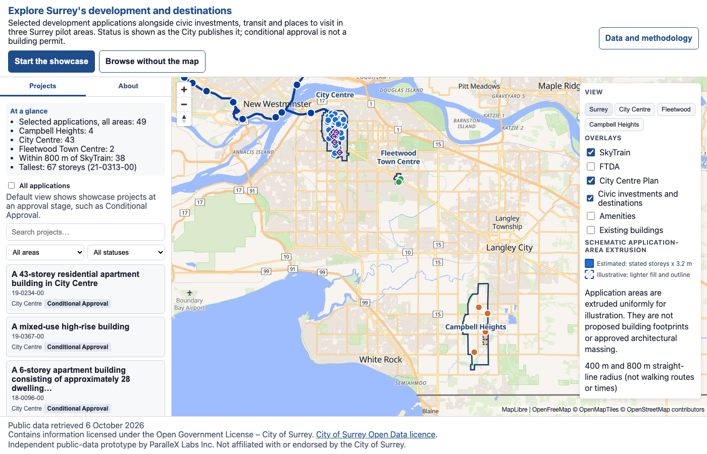

How it was made: its code and documentation were written with AI coding assistants and reviewed, tested and revised by Amir Daneshpajouh.

**Try it live:** https://parallexlabs.ca/demos/surrey/ (no install), or the GitHub Pages copy at https://parallexlabs.github.io/surrey-devviz-prototype/.

[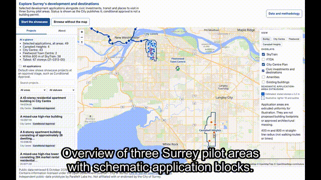](https://parallexlabs.github.io/surrey-devviz-prototype/media/demo.mp4)

*Demo walkthrough (captions burned in; WebVTT: [docs/media/demo.en.vtt](docs/media/demo.en.vtt)).*

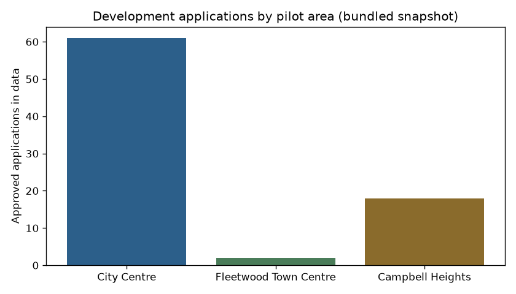

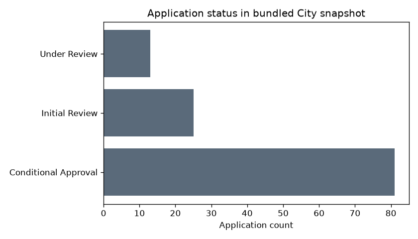

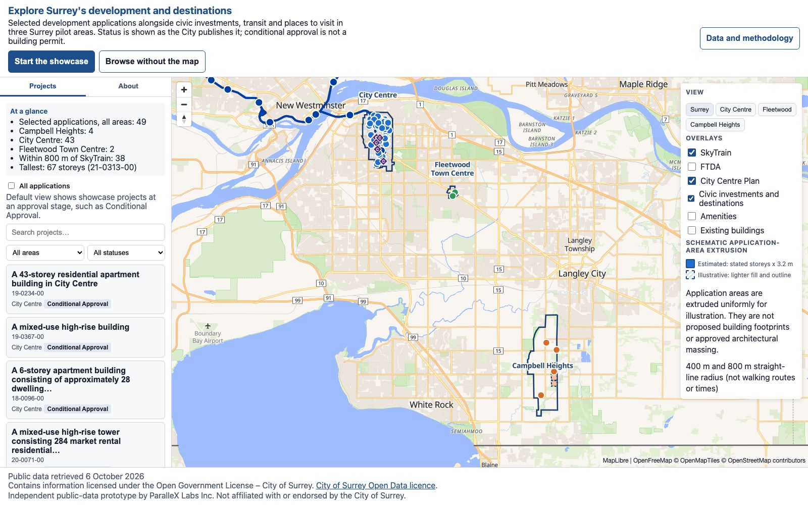

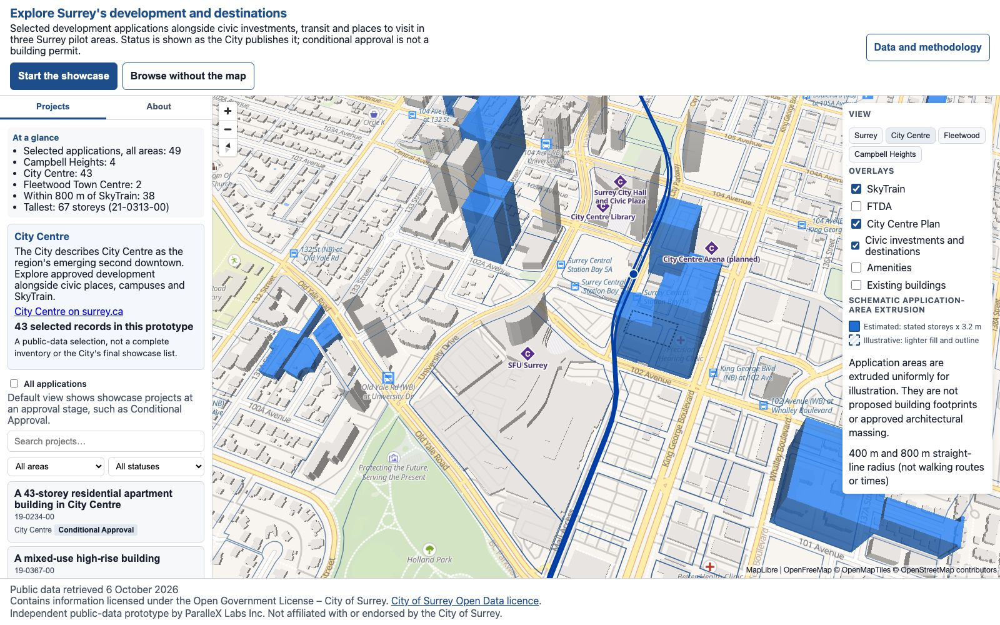

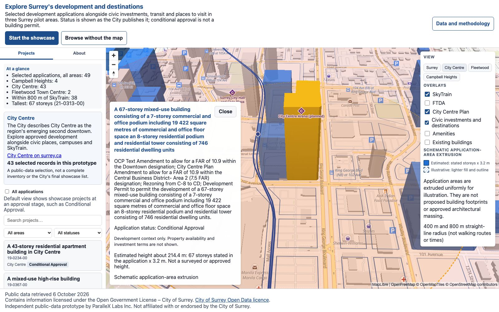

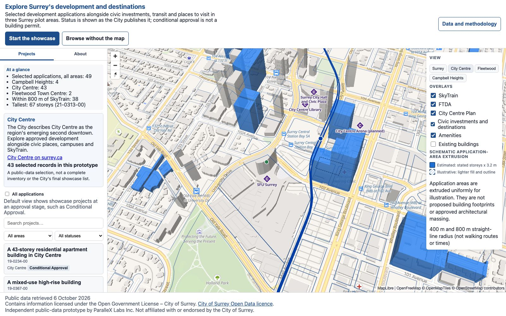

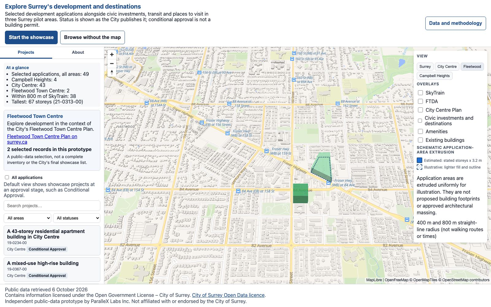

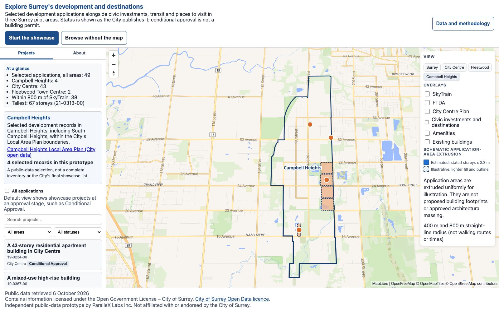

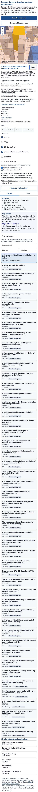

*Screenshots on this page: basemap © OpenMapTiles, © OpenStreetMap contributors, served by OpenFreeMap. Plan areas and application outlines contain information licensed under the Open Government License – City of Surrey.*

## How it works

1. Download public City of Surrey layers and OpenStreetMap transit and amenity features.
2. Select showcase projects with a rule based on the City's application status.
3. Estimate schematic heights: storeys times 3.2 m where stated, otherwise an illustrative height.
4. Build the static site: map, project list, filters and methodology panel.
5. Open the demo and choose **Start the showcase**.
6. Open a project card and follow its City source link.
7. Open **Data and methodology**.
8. Copy a share link to the selected preset view and project.

## Architecture

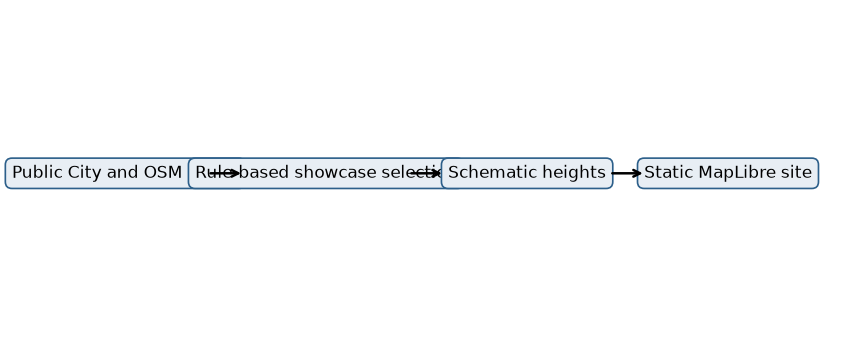

- **Data**: frozen GeoJSON and JSON under `public/data/`, refreshed with `scripts/fetch_data.py`.
- **Logic**: showcase rules, height estimation and proximity in `src/`.
- **Client**: Vite and MapLibre GL; static output only, no backend.
- **Deploy**: `npm run build:site` for https://parallexlabs.ca/demos/surrey/; `npm run build:pages` for GitHub Pages under `docs/`.

## Design choices

- **Rule-based showcase**: the default list uses inclusion and exclusion rules on application text and approved statuses, not manual curation.
- **Schematic blocks**: application areas are extruded for illustration; they are not proposed footprints or approved massing.
- **Deferred footprints**: building footprints load only when toggled, so the first view stays smaller.
- **Share links**: the URL hash keeps the preset view and selected project, not manual camera moves.

## Why it matters

Development applications in three Surrey areas are on one map, each linked to its City source.

## Showcase media

Regenerate hero images, charts and the demo recording:

```bash
npm ci
npm run build:site
python3 scripts/make_showcase_media.py
```

Requires Playwright Chromium (`npx playwright install chromium`), Python 3 with matplotlib, ffmpeg and exiftool on the paths used in the script.

Built by [ParalleX Labs Inc.](https://parallexlabs.ca/) This prototype is **not affiliated with or endorsed by the City of Surrey** and is not a regulatory record.

## Review it in one minute

1. Open the demo: https://parallexlabs.ca/demos/surrey/
2. Choose **Start the showcase**.
3. Open one project card and its City source link.
4. Open **Data and methodology**.
5. Copy a share link.

## Prototype boundaries

- Public data only.
- Heights are schematic.
- This is not a City service.
- No accessibility audit is claimed beyond the automated checks.

The checks that were run, and what was not done, are in [VERIFICATION.md](VERIFICATION.md).

## Features

- **2D and 3D map**: pan, zoom, and tilt; switch to a pitched 3D view in City Centre.
- **Schematic application-area extrusion**: when an application description states a storey count, height is estimated as storeys × 3.2 m. When no storey count can be read, an illustrative height is used. The parser does not read heights stated in metres. Application areas are extruded uniformly for illustration. They are not proposed building footprints or approved architectural massing. See *Data and methodology* in the app and `src/heights.js`.
- **Project list and filters**: browse and filter applications without relying on the map; keyboard-accessible list with status and pilot-area filters.
- **Transit and amenity context**: SkyTrain lines and stations, Frequent Transit Development Areas, civic amenities, and optional City Centre Plan overlay.
- **Guided tour**: step-through introduction to the map, overlays, and project panel.
- **Shareable links**: the URL hash encodes the selected preset view and the selected project only. Manual camera position, zoom, pitch, and bearing are not preserved.
- **Accessibility**: skip link, visible focus, keyboard navigation, ARIA labels, and axe-tested states (see `npm run test:axe` locally).
- **Phone layout**: single-column layout with scrollable content, 16 px body text, and touch targets sized for mobile use.

## Data sources and licences

All geographic data ships in `public/data/`. City of Surrey layers come from the City's ArcGIS open-data services. SkyTrain and amenity features come from OpenStreetMap via the Overpass API.

See [DATA_LICENSE.md](DATA_LICENSE.md) for required attribution, source URLs, and basemap credits. A machine-readable source list is in `public/data/SOURCES.json`. The OpenStreetMap files, their attribution, and the ODbL link are also in [public/data/README.md](public/data/README.md).

The default project list is a rule-based selection using the source status, including conditional approval. That status is the City's application status. It is not a building permit and it does not say whether construction has started.

To refresh data from the public APIs (requires Python 3 and Shapely 2):

```bash
python3 -m pip install 'shapely>=2.0,<3'
npm run fetch-data
```

## Run locally

Requirements: Node.js 22 LTS and npm.

```bash
npm ci
npm run dev
```

Open http://localhost:5173/

## Test

Unit tests include the Python 3 data tests. Those need Python 3 with Shapely (`pip install shapely`).

```bash
npm test
```

End-to-end tests (Playwright; needs a GPU-backed Chromium browser, not run in CI) need a site build first:

```bash
npm run build:site
npx playwright install chromium
npm run test:e2e
```

Accessibility scan (Playwright + axe):

```bash
npm run test:axe
```

## Build

Production build to `dist/`:

```bash
npm run build
npm run preview
```

Site build for `/demos/surrey/` deployment (writes `dist-site/`):

```bash
npm run build:site
```

GitHub Pages build (writes `dist-pages/`, synced into `docs/` by `scripts/make_showcase_media.py`):

```bash
npm run build:pages
```

## Load profile

Measured with `node scripts/measure-load.mjs` on the built site served by `npm run serve:site`. The script uses Fast 4G: 165 ms latency and 1,012,500 bytes per second. The figures below are that run's transfer sizes.

Before building footprints were deferred, they were still downloaded on first idle:

- First contentful paint: 568 ms
- First meaningful paint: 2,666 ms
- Transfer at meaningful paint: 1,803,261 bytes
- Transfer after idle: 7,774,830 bytes
- Requests: 19
- Largest response: `building_footprints.geojson`, 4,383,195 bytes

After building footprints load only when that layer is first checked:

- First contentful paint: 548 ms
- First meaningful paint: 2,578 ms
- Transfer at meaningful paint: 1,797,846 bytes
- Transfer after idle: 3,386,220 bytes
- Requests: 18
- Largest response: the built script, 1,104,341 bytes

`building_footprints.geojson` was not requested in the second run.

## Open by design

- **Public inputs only**: no API keys, no proprietary datasets, and no backend beyond static files and public tile endpoints.
- **Documented method**: showcase inclusion rules, height estimation, and limitations are stated in the in-app *Data and methodology* panel (`src/methodology.js`).
- **Reproducible data**: `scripts/fetch_data.py` downloads the same public sources recorded in `SOURCES.json`.
- **No tracking**: the page does not use analytics, cookies, localStorage, or sessionStorage. Third-party requests are limited to OpenFreeMap (style, tiles, fonts).
- **Open source**: application code is licensed under [Apache-2.0](LICENSE). Data files remain under their respective open licences (see [DATA_LICENSE.md](DATA_LICENSE.md)).
- **Security**: see [SECURITY.md](SECURITY.md).

## Licence

Copyright 2026 ParalleX Labs Inc. Code is licensed under the Apache License 2.0. See [LICENSE](LICENSE).
